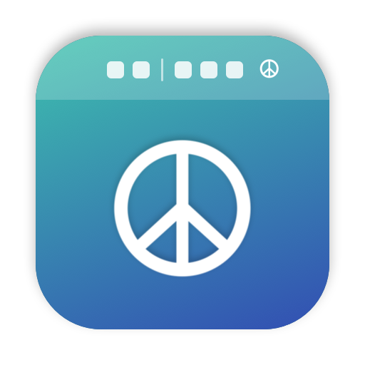
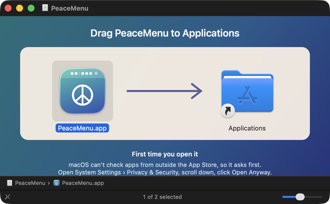

<p align="center">
  
</p>

# PeaceMenu

[](https://github.com/spoulin/peace-menu/releases/latest/download/PeaceMenu.dmg)

For macOS 14 or later, on Apple silicon and Intel Macs. See [Install](#install).

A menu bar organizer for macOS. It hides the icons you don't need, sorts the others into
named groups you can fold and unfold with a click, and switches between profiles: a different
set of groups for work, for focus, or for the small screen of a laptop.

## What it does

- **Hides icons.** Click ☮ to show or hide the icons that are in no group. Icons of folded groups
  and of groups left out of the profile stay hidden even then.
- **Groups.** Put icons in named groups. Each group has a title in the menu bar (a name, a symbol,
  a line, a dot or a space) and an optional color. Click a title to show or fold its icons; the
  choice is kept.
- **Profiles.** A profile says which groups show, in which order. Switch profiles from the ☮ menu.
- **Change signal.** When an icon of a folded group changes (a VPN disconnects, for example), an
  orange dot appears on the group's title, and the icon shows next to it for a moment.
- **New icons.** When an app adds an icon, PeaceMenu puts it in its group, or behind the others.
- **The purple recording indicator.** macOS never lets an app hide it; PeaceMenu keeps it at the
  left end, out of the way of your groups.

From left to right, the menu bar looks like this:

```
[always hidden…] ‹‹ [hidden…] ‹ [groups and their icons] ☮ [always visible] clock
```

## Install

1. Download [PeaceMenu.dmg](https://github.com/spoulin/peace-menu/releases/latest/download/PeaceMenu.dmg)
   and open it.
2. Drag PeaceMenu onto Applications.

   

3. Open PeaceMenu from Applications. macOS says it can't check the app: click **Done**
   (not Move to Trash).
4. Open System Settings › Privacy & Security, scroll down to Security, and click
   **Open Anyway** next to “PeaceMenu.app” was blocked. Confirm with your password.
   You only do this once.
5. PeaceMenu asks for **Accessibility**: allow it in System Settings › Privacy & Security ›
   Accessibility. It needs it to read the menu bar icons and move them. The permission stays
   from one version to the next.

PeaceMenu isn't notarized by Apple: it's signed with its own certificate, not tied to an Apple
developer account. That's why macOS asks first.

**Updates.** Right-click ☮ › Check for Updates… opens the latest release. Download the new disk
image and drag PeaceMenu onto Applications again, replacing the old one.

**Clicked Move to Trash by mistake?** Download the disk image again and start over.

## Use

| | |
|---|---|
| Click ☮ | Show or hide the icons that are in no group |
| Right-click or ⌥-click ☮ | Profiles, groups, Settings, Check for Updates |
| Click a group title | Show or fold the group's icons |
| Right-click a group title | The group's menu |
| ⌘-drag an icon right of ☮ | It always stays visible |

**Settings › Groups:** create groups, add icons to them, pick the title's style and color.
**Settings › Profiles:** choose the groups each profile shows and their order (top to bottom is
left to right in the menu bar). **Settings › General:** when hidden icons hide again, what happens
when an icon of a folded group changes, launch at login.

## How it works

macOS has no public way to move another app's menu bar icon, so PeaceMenu does what you would do:
a ⌘-drag. While it moves icons, your clicks are held off for a moment and the cursor shows a
spinning wheel. Hidden icons sit off screen, pushed there by the stretched ‹ and ‹‹ separators.

Measured on macOS 26: every menu bar icon window belongs to Control Center, so PeaceMenu finds
which icon is whose through Accessibility. A log of what it moved is kept in
`~/Library/Logs/PeaceMenu.log`.

## Build

```bash
./build.sh
```

builds `build/PeaceMenu.app`, signs it and installs it in `~/Applications`. `NO_INSTALL=1` only
builds; `UNIVERSAL=1` builds for Apple silicon and Intel Macs.

### Releases

A version tag builds the app on GitHub, makes the disk image and publishes a release:

```bash
git tag v1.0.0 && git push origin v1.0.0
```

To make the disk image locally (with [dmgbuild](https://github.com/dmgbuild/dmgbuild) installed):

```bash
UNIVERSAL=1 NO_INSTALL=1 ./build.sh
NAME="PeaceMenu" COLORS="1E6E78 245A8C 25307A" tools/make-dmg.sh build/PeaceMenu.app PeaceMenu.dmg
```
